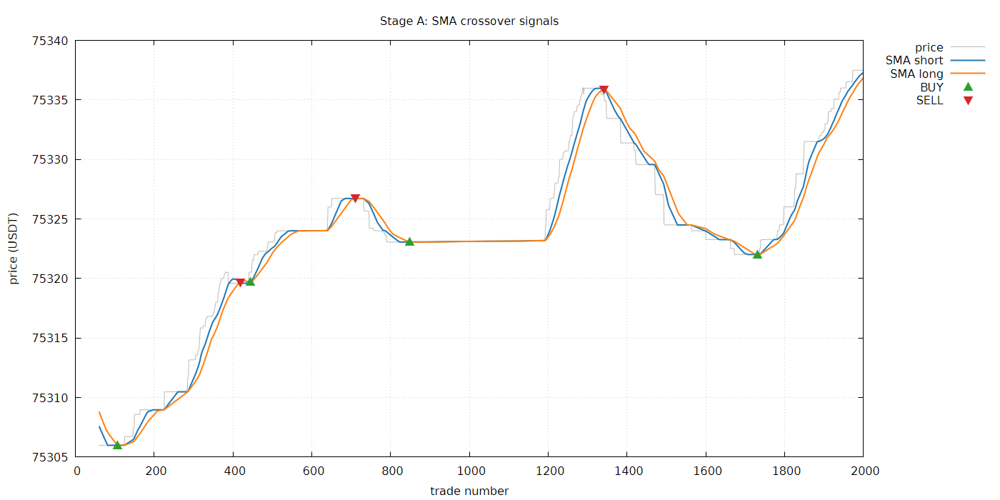

# Tick-to-Trade on the Edge: Final Report (Group 06)

## 1. Introduction

### 1.1 Project Overview

This project builds a low-latency market data engine in standard C and benchmarks it on
two machines: a personal laptop (CSC1103) and a Raspberry Pi 5 (CSC1104). The engine acts
as a low-cost "signal box" for high-frequency trading. It reads real cryptocurrency trades
from Binance's public market data, computes trading indicators as each trade arrives, and
raises BUY or SELL signals, shown on the Pi's status LED and in the terminal.

The engine computes four things for every trade:

- **VWAP** (volume-weighted average price): the running sum of price × quantity divided
  by the running sum of quantity.
- **One-second OHLC bars** (open, high, low, close), found by integer division of each
  timestamp by 1,000,000.
- **A short and a long simple moving average (SMA)** of the price, each kept in a circular
  array.
- **A crossover signal:** BUY when the short SMA rises above the long SMA, SELL when it
  falls below.

The work is organised as a sequence of stages, each one faster than the last:

| Stage | What it adds |
|---|---|
| 0 | Environment check and baseline benchmarks (`-O0` to `-O3`, recursion vs iteration, LED control) |
| A | Streaming engine using the provided helper library (`fgets` + `sscanf`); this is **Version 0**, the baseline for every speedup |
| A+ | Own reader using pointer parameters, then a digit-by-digit parser replacing `sscanf` |
| B | In-memory engine: all trades loaded into a `Trade` array, running-sum SMA, fixed-point prices |
| C | `malloc`'d array, real-time replay at 1×, 100× and 1000×, latency measurement, and trading against a rival bot |

Each stage keeps a version of the program, giving an efficiency ladder from V0 to V8 that
is benchmarked on `stress_full.csv` on both machines.

### 1.2 Objectives

1. **Correctness:** every version must produce the same results on `test20.csv` as the
   reference file `test20_expected.txt`.
2. **Speed:** make the engine as fast as possible, and measure each step (time, ns per
   trade, throughput in trades per second, and speedup against Version 0).
3. **Understand the hardware:** explain each speedup with evidence from `perf stat`
   (cycles, instructions, IPC, cache misses) and memory measurements, and compare the
   laptop with the Pi.
4. **Fair benchmarking:** time with `now_ns()`, run each measurement at least 5 times and
   report the median; on the Pi, pin to one core with `taskset` and set the CPU governor to
   `performance`.
5. **Real-time trading:** replay trades at their real timing, measure the latency from a
   trade's arrival to its signal, and show how much money slow code loses against a rival
   bot that reacts in R µs.
6. **Predict, measure, explain:** record a prediction before each measurement in a
   logbook, then explain why the result matched or differed.

### 1.3 Group Parameters (Short/Long SMA Windows)

| File | Short SMA window | Long SMA window | Set by |
|---|---|---|---|
| `test20.csv` | 3 trades | 5 trades | the same for every group |
| `dev_1M.csv` | 35 trades | 60 trades | Group 06 |
| `stress_full.csv` | 35 trades | 60 trades | Group 06 |

The windows are counted in trades, not in time. Every version reads them from one place,
`src/config.h` (`TEST_SHORT`/`TEST_LONG` and `DEV_SHORT`/`DEV_LONG`), so all versions use
the same values.

Other fixed parameters:

- **Rival bot:** standard reaction time R = 1 µs, swept from 0.1 µs to 100 µs.
- **Position size:** start with 0 BTC; BUY 1 BTC when holding none, SELL it when holding
  one.

### 1.4 Dataset Description (test20.csv, dev_1M.csv, stress_full.csv)

All three files come from one day of Bitcoin trades on Binance, 21 August 2026 (UTC).
There is no header row: every line is one trade.

| File | Trades | Size | Time covered (UTC) | Price range | Used for |
|---|---|---|---|---|---|
| `test20.csv` | 20 | 1.5 KB | 07:18:10.78 to 07:18:10.98 (0.2 s) | 76,589.57 to 76,592.36 | Correctness check against `test20_expected.txt` |
| `dev_1M.csv` | 1,000,000 | 75.9 MB | 05:52:10 to 08:20:13 (about 2.5 hours) | 75,104.00 to 77,270.67 | Development and debugging |
| `stress_full.csv` | 8,928,944 | 677.8 MB | 00:00:00 to 23:59:59 (the whole day) | 73,027.02 to 79,500.00 | Final benchmarks |

`dev_1M.csv` is trades 1,982,236 to 2,982,235 of `stress_full.csv`, and `test20.csv` is
20 consecutive trades taken from within `dev_1M.csv`.

Each line has seven comma-separated fields:

| # | Field | Example | Meaning |
|---|---|---|---|
| 1 | `id` | `6593041135` | Trade ID (consecutive) |
| 2 | `price` | `76589.57000000` | Price of 1 BTC |
| 3 | `qty` | `0.00007000` | Quantity traded, in BTC |
| 4 | `quoteQty` | `5.36126990` | Price × quantity |
| 5 | `time` | `1787296690782142` | Timestamp in microseconds since 1 January 1970 |
| 6 | `isBuyerMaker` | `False` | `False`: a buyer started the trade (counted as a BUY); `True`: a seller did |
| 7 | `isBestMatch` | `True` | Whether the trade was the best price match |

Reference results for Version 0 (the baseline). The running-sum SMA (V4) and
fixed-point prices (V5 and up) change these signal counts slightly, by design, because
they round differently:

| File | Final VWAP | BUY signals | SELL signals |
|---|---|---|---|
| `dev_1M.csv` | 76,217.01291587 | 2,509 | 2,469 |
| `stress_full.csv` | 76,718.67569936 | 20,386 | 20,176 |


---

## 2. Design Solution

### 2.1 Problem Definition

Given a file of trades in time order, the engine must, for every trade:

1. update the VWAP of all trades so far;
2. place the trade in its one-second OHLC bar, closing the previous bar when a new second
   starts;
3. update a short (35-trade) and a long (60-trade) SMA of the price;
4. decide whether the short SMA has crossed the long SMA, and raise BUY or SELL.

It must give exactly the expected results on `test20.csv`, and it must do this as fast as
possible on a Raspberry Pi 5, because a signal that arrives late loses money to a faster
rival bot. The simplest correct program (Version 0) is too slow for this: on the Pi it
takes 10.84 s for `stress_full.csv`, about 1.2 µs per trade, which is slower than the
rival bot's standard reaction time of 1 µs.

### 2.2 Problem Analysis

#### 2.2.1 Inputs and Outputs

**Inputs**

| Input | Source | Notes |
|---|---|---|
| Trade file | `test20.csv`, `dev_1M.csv` or `stress_full.csv`, picked by a command-line argument (`test20`, `dev`, `stress`) | The engine uses `price`, `qty`, `time` and `isBuyerMaker`, and ignores `id`, `quoteQty` and `isBestMatch` |
| SMA windows | `src/config.h` | 3 / 5 for test20; 35 / 60 for dev_1M and stress_full |

**Outputs**

| Output | When | Contents |
|---|---|---|
| Per-trade table | test20 only | Trade number, price, quantity, side, VWAP, short SMA, long SMA, signal |
| OHLC bars | test20 only | Second, open, high, low, close, number of trades |
| Signal list | dev and stress | The first 10 BUY/SELL signals and the trade each occurred at |
| Summary | every run | Final VWAP, total BUY signals, total SELL signals |
| LED and coloured terminal | Stage C replay | Green for BUY, red for SELL |

Timed versions never write plot files (`signals.dat`, `signals.png`), and they are timed
from outside with `now_ns()`, so printing does not distort the timing.

#### 2.2.2 Indicators and Formulas (VWAP, SMA, Crossover, OHLC)

**VWAP.** For trades 1 to t with price pᵢ and quantity qᵢ:

**VWAP(t) = (p₁q₁ + p₂q₂ + … + pₜqₜ) ÷ (q₁ + q₂ + … + qₜ) = Σ pᵢqᵢ ÷ Σ qᵢ**

Only two running sums are kept, so each trade costs one multiplication and two additions.

**SMA.** The simple moving average of the last N prices, defined once N trades have been
seen:

**SMA_N(t) = (pₜ₋ₙ₊₁ + … + pₜ₋₁ + pₜ) ÷ N**, the sum of the last N prices divided by N

- *Naive (V0 to V3):* re-add all N prices on every trade, O(N) per trade.
- *Running sum (V4 onwards):* keep the window sum and update it with
  S(t) = S(t−1) + p(t) − p(t−N), which is O(1) per trade.

**Crossover.** Once both SMAs exist, compare this trade with the previous one:

- **BUY** if SMA_short(t−1) ≤ SMA_long(t−1) and SMA_short(t) > SMA_long(t)
- **SELL** if SMA_short(t−1) ≥ SMA_long(t−1) and SMA_short(t) < SMA_long(t)

From V5, prices are fixed-point integers and the test uses
d = sum_short × 60 − sum_long × 35. This has the same sign as SMA_short − SMA_long, but
needs no division and is exact.

**One-second OHLC.** The bar a trade belongs to is

**sec = ⌊time ÷ 1,000,000⌋**, integer division, so the remainder is dropped

Within one second: open = first price, high = highest price, low = lowest price,
close = last price, n = number of trades. A trade with a new `sec` closes the current bar
and starts a new one, and the last bar is closed after the final trade.

**Fixed-point prices (V5 onwards).** Prices are stored × 100 (cents) and quantities
× 100,000. Both are exact for this data (at most 2 and 5 decimals). The largest value
needed, the day's VWAP sum of about 3.4 × 10¹⁶, fits in a `long long` (up to about
9.2 × 10¹⁸) with about 270× headroom. Scaling quantities by 10⁸ instead would overflow.

#### 2.2.3 Constraints (Speed, Memory, Power)

**Speed**
- `stress_full.csv` has 8.93 million trades. To keep up with a rival that reacts in 1 µs,
  each trade must be handled in well under 1 µs.
- Version 0 takes about 1.2 µs per trade on the Pi. Profiling showed that 84% of that is
  `sscanf` turning text into numbers, so parsing is the first thing to speed up.
- Replay at 1000× speed delivers on average about 103,000 trades per second
  (8.93 million trades in 86,400 s, × 1000), so about 9.7 µs per trade on average.

**Memory**
- The streaming versions (V0 to V2) keep only one line and two SMA windows of at most 128
  prices, so they use about 1 MB whatever the file size.
- Holding every trade in memory (V3 onwards) needs 32 bytes per trade: 8.93 million ×
  32 B ≈ 286 MB. The fixed-size global array is sized for 10 million trades (320 MB).
- V7 also holds the whole 678 MB file in one buffer, about 920 MB in total.
- All of these fit in the Pi's 8 GB, but the in-memory versions use about 270× more
  memory than the streaming ones.

**Power**
- The Pi 5 is a low-power edge device, and the engine runs on one pinned core.
- Fewer instructions and cycles per trade means less energy per trade, so the instruction
  and cycle counts from `perf stat` are used to judge efficiency.

**Precision**
- With `double` prices, a running sum rounds slightly differently from re-adding the
  window, which changes a few crossover decisions. Fixed-point integers make every sum
  exact, at the cost of checking for overflow.

### 2.3 Pseudocode

#### 2.3.1 Main Processing Loop

Streaming version (V0 to V2): read one trade, update everything, move on.

```
run(path, short_win, long_win, print_table):
    if short_win >= long_win or long_win > MAX_WIN: error
    open path
    vwap_init(); ohlc_init()
    sma_init(SHORT, short_win); sma_init(LONG, long_win)
    crossover_init()

    while read next trade (time, price, qty, is_buy):
        vwap_update(price, qty)
        if ohlc_update(time, price) and print_table: print finished bar
        sma_push(SHORT, price); sma_push(LONG, price)
        signal = NONE
        if sma_ready(SHORT) and sma_ready(LONG):
            signal = crossover_update(sma_value(SHORT), sma_value(LONG))
        if print_table: print trade row
        else if signal != NONE and fewer than 10 printed: print signal

    if ohlc_flush() and print_table: print last bar
    close file
    print summary(vwap_value(), buys, sells)
```

In-memory version (V3 onwards): the same loop body, run over an array.

```
n = load_trades(path, trades)       # read and parse the whole file once   (Load)
for i = 0 to n - 1:                  # no file access inside the loop       (Process)
    same updates as above, using trades[i]
```

#### 2.3.2 VWAP

```
vwap_init():          sum_pq = 0; sum_q = 0

vwap_update(p, q):    sum_pq = sum_pq + p * q
                      sum_q  = sum_q + q

vwap_value():         if sum_q > 0: return sum_pq / sum_q
                      else:         return 0
```

#### 2.3.3 Circular Buffer SMA

Each window is an array of size N used as a ring. `head` is the next slot to overwrite,
so once the window is full, the oldest price is always at `head`.

```
sma_init(N):    head = 0; count = 0; sum = 0
sma_ready():    return count == N

# naive (V0 to V3)
sma_push(p):    win[head] = p
                head = (head + 1) mod N
                if count < N: count = count + 1
sma_value():    total = 0
                for i = 0 to N - 1: total = total + win[i]
                return total / N

# running sum (V4 onwards)
sma_push(p):    if count == N: sum = sum - win[head]    # drop the oldest price
                win[head] = p
                sum = sum + p
                head = (head + 1) mod N
                if count < N: count = count + 1
sma_value():    return sum / N
```

#### 2.3.4 Crossover Signal Detection

```
crossover_init():    have_prev = false; buys = 0; sells = 0

crossover_update(s, l):          # s = short SMA, l = long SMA for this trade
    signal = NONE
    if have_prev:
        if prev_s <= prev_l and s > l:        signal = BUY;  buys = buys + 1
        else if prev_s >= prev_l and s < l:   signal = SELL; sells = sells + 1
    prev_s = s; prev_l = l; have_prev = true
    return signal
```

Fixed-point version (V5 onwards): the same, but using the sign of
`d = sum_short * long_win - sum_long * short_win` (BUY if prev_d ≤ 0 and d > 0; SELL if
prev_d ≥ 0 and d < 0).

#### 2.3.5 One-Second OHLC Bars

```
ohlc_init():    active = false

ohlc_update(time, p):
    sec = time / 1000000                       # integer division
    if not active or sec != bar.sec:
        closed = active
        if active: finished = bar              # this trade closes the old bar
        bar = {sec, open = p, high = p, low = p, close = p, n = 1}
        active = true
        return closed
    if p > bar.high: bar.high = p
    else if p < bar.low: bar.low = p
    bar.close = p
    bar.n = bar.n + 1
    return false

ohlc_flush():   if active: finished = bar; active = false; return true
                return false
```

### 2.4 Program Structure and Modules

Every ladder version is built from the same small modules in `src/`, so each version
differs from the one before it only in the module that was swapped. Each module has an
`init` function, an `update` function and functions that return its values. The `double`
modules (V0 to V4) keep their state in private `static` variables inside their `.c` file;
the fixed-point modules (V5 onwards) keep it in a struct passed by pointer.

| Folder / file | Module | Purpose |
|---|---|---|
| `src/config.h` | configuration | File paths and SMA windows, shared by every version |
| `src/*_main_*.c` | main programs | One `main` per stage: arguments, the main loop, the summary |
| `helper_function/trade_io.c` | helper reader (V0) | `fgets` + `sscanf`, the provided library |
| `src/reader/` | own readers | V1 `fgets` + `sscanf` through pointers; V2 to V4 digit-by-digit parser; V5+ fixed-point parser |
| `src/store/` | trade storage | V3/V4 global `Trade` array; V5 and V8 global `TradeFx` array; V6 `malloc`'d array; V7 whole file read with `fread` |
| `src/engine/` | `double` indicators | `vwap.c`, `ohlc.c`, `signal.c`, `report.c`, naive SMA (V0 to V3), running-sum SMA (V4) |
| `src/engine_fx/` | fixed-point indicators | VWAP, OHLC, running-sum SMA and exact crossover on `long long` (V5 onwards) |
| `src/engine_asm/` | assembly (V8, Pi only) | Hand-written AArch64 OHLC (`v8_ohlc_fx.s`) and SMA (`v8_sma_fx.s`) |
| `helper_function/timing.h`, `led.h` | support | `now_ns()` timer and the Pi LED |
| `benchmark/` | `ladder_bench` | Builds every version at every flag level and benchmarks it |
| `stageC/` | Stage C programs | Real-time replay (`stageC_replay.c`) and the rival bot (`stageC_rival.c`) |

The modules each ladder version is built from (`make ladder`):

| Version | Main | Reader | Storage | Indicators |
|---|---|---|---|---|
| V0 | `v0_main_stageA.c` | helper `trade_io.c` | streams the file | `engine/` + naive SMA |
| V1 | `v1-v2_main_stageAplus.c` | `v1_read_trade_sscanf.c` | streams the file | `engine/` + naive SMA |
| V2 | `v1-v2_main_stageAplus.c` | `v2-v4_read_trade_fast.c` | streams the file | `engine/` + naive SMA |
| V3 | `v3-v4_main_stageB_inmem.c` | `v2-v4_read_trade_fast.c` | `v3-v4_trades.c` (global array) | `engine/` + naive SMA |
| V4 | `v3-v4_main_stageB_inmem.c` | `v2-v4_read_trade_fast.c` | `v3-v4_trades.c` (global array) | `engine/` + running-sum SMA |
| V5 | `v5-v8_main_stageB_fixed.c` | `v5-v8_read_trade_fx.c` | `v5_trades_fx_array.c` (global array) | `engine_fx/` |
| V6 | `v5-v8_main_stageB_fixed.c` | `v5-v8_read_trade_fx.c` | `v6_trades_fx_malloc.c` (`malloc`) | `engine_fx/` |
| V7 | `v5-v8_main_stageB_fixed.c` | `v5-v8_read_trade_fx.c` | `v7-v8_trades_fx_fread.c` (`fread`) | `engine_fx/` |
| V8 | `v5-v8_main_stageB_fixed.c` | `v5-v8_read_trade_fx.c` | `v5_trades_fx_array.c` (global array) | `engine_fx/` with the OHLC or SMA in assembly |

The `Trade` struct puts its largest fields first, so it packs into 32 bytes. `TradeFx`
has the same layout with `long long` price and quantity:

```c
typedef struct {
    long long time;     /* timestamp in microseconds           */
    double    price;    /* TradeFx: long long, price x 100     */
    double    qty;      /* TradeFx: long long, qty x 100000    */
    int       is_buy;   /* 1 = buy, 0 = sell                   */
} Trade;
```


---

## 3. System Set-up

### 3.1 Laptop Set-up (CSC1103)

Each member benchmarked on their own laptop.

| Specification | Joel | (name) | (name) | (name) | (name) |
|---|---|---|---|---|---|
| Device | Acer Swift SFE14-51T | | | | |
| CPU | Intel Core Ultra 9 288V, 8 cores / 8 threads, up to 5.1 GHz | | | | |
| Memory (RAM) | 31.6 GB | | | | |
| OS | Windows 11 Home 25H2, 64-bit (build 26200) | | | | |
| Compiler | gcc 15.2.0 (MSYS2 UCRT64, Rev8) | | | | |
| Power mode | "Best performance", plugged in | | | | |
| Python | 3.14.7 | | | | |

On every laptop: flags `-Wall` with `-O0`, `-O1`, `-O2`, `-O3`, and no core pinning
(`taskset` is Linux only).

### 3.2 Raspberry Pi 5 Set-up (CSC1104)

| Specification | Raspberry Pi 5 |
|---|---|
| Model | Raspberry Pi 5 Model B Rev 1.1 |
| CPU | Arm Cortex-A76, 4 cores, 2.40 GHz |
| Memory (RAM) | 8 GB (7.9 GB usable) |
| OS | Raspberry Pi OS 64-bit (Debian 12 bookworm) |
| Kernel | `6.12.115+rpt-rpi-2712` (aarch64), 16 KB pages |
| Compiler | gcc 12.2.0 (Debian 12.2.0-14) |
| Flags | `-Wall` with `-O0`, `-O1`, `-O2`, `-O3`, `-O3 -mcpu=cortex-a76` |
| CPU governor | `performance` |
| Core pinning | `taskset -c 2` (one core) |
| Tools | `perf stat`, Valgrind 3.19.0 |
| Python | 3.11.2 |

Source: `benchmark/results/joel/{laptop,rpi}/device.txt` and `logs/JoelStageA/joel_pi/system.txt`.

### 3.3 Benchmarking Methodology (Median of 5 Runs, taskset, CPU Governor)

- **Dataset:** every version is benchmarked on `stress_full.csv` (8,928,944 trades), and
  must first pass `test20.csv`.
- **Tool:** the group's `ladder_bench` builds every version at every flag level and runs it.
- **Runs:** 1 warm-up run (not counted), then 5 timed runs. The **median** is reported,
  so one slow run cannot distort the result.
- **Timer:** `now_ns()`. V0 to V2 are timed from launch to exit; V3 and up report their
  own Load + Process time for `stress_full.csv`.
- **Reported per version:** time, ns per trade, throughput (trades/s) and speedup against
  Version 0 (`-O2`).
- **Pi only:**
  - `taskset -c 2` pins the program to one core, so it is never moved between cores.
  - The `performance` governor keeps the CPU at its full clock, so the speed does not
    change during a run.
  - `perf stat` records cycles, instructions, IPC and cache misses on one extra untimed
    run.
- **Memory:** peak memory is recorded on that same extra run (peak working set on
  Windows, max RSS on the Pi).
- **No plot files** are written by any version that is timed.


---

## 4. Stage 0: Getting Started on the Pi

### 4.1 Sum Loop Timings at -O0, -O1, -O2, -O3

We summed 1 to N with N = 100,000,000 in two versions: `a_loop_sum.c` reads N from the
user, and `a_loop_sum_fixed.c` sets N in the code. Both print 5000000050000000. Times are
the fastest of 3 runs on each machine. Speedup = `-O0` time / `-Ox` time.

**N entered by the user (`a_loop_sum.c`)**

| Flag | Laptop time | Laptop speedup | Pi time | Pi speedup |
|---|---|---|---|---|
| `-O0` | 75.8 ms | 1.00× | 2,822.0 ms | 1.00× |
| `-O1` | 47.2 ms | 1.61× | 857.2 ms | 3.29× |
| `-O2` | 41.6 ms | 1.82× | 450.0 ms | 6.27× |
| `-O3` | 37.4 ms | 2.03× | 450.8 ms | 6.26× |

**N fixed in the code (`a_loop_sum_fixed.c`)**

| Flag | Laptop time | Laptop speedup | Pi time | Pi speedup |
|---|---|---|---|---|
| `-O0` | 75.6 ms | 1.00× | 278.2 ms | 1.00× |
| `-O1` | 48.2 ms | 1.57× | 41.7 ms | 6.67× |
| `-O2` | under 100 ns | loop removed | under 100 ns | loop removed |
| `-O3` | under 100 ns | loop removed | under 100 ns | loop removed |

Compiling with the various levels of optimisation from `-O0` to `-O3` made the user-input
loop 2.03× faster on the laptop and 6.26× faster on the Pi. When N was fixed in the code,
`-O2` and `-O3` removed the loop entirely.

The Pi user-input `-O0` time is about 10× slower than the Pi fixed `-O0` time, even though
both run the same loop. A second run gave 2,825,970,642 ns, so it is not a typo, but the
cause is still unknown.

Source: `stage0/question_a/output.txt`.

### 4.2 Optimiser Behaviour Observations

- **`-O0` to `-O1`: variables move into registers.** At `-O0`, gcc reads and writes `i`
  and `total` in memory on every pass of the loop. From `-O1` it keeps them in CPU
  registers, which removes most of the memory traffic. This is the biggest single step on
  both machines.
- **`-O2` and `-O3` with N fixed: the loop is removed.** When N is known at compile time,
  gcc works out the whole sum while compiling. The `-O2` assembly contains
  5000000050000000 as a constant and has no loop at all, so the program only prints the
  answer.
- **`-O2` and `-O3` with N from the user: the loop must stay.** N is only known when the
  program runs, so the loop still runs. `-O3` gives little or nothing over `-O2` (laptop
  1.82× to 2.03×, Pi 6.27× to 6.26×) because a loop this simple has nothing more to
  optimise.
- **Times under 100 ns measure the timer, not the code.** The laptop timer counts in steps
  of 100 ns, so tiny results show only 0 or 100 ns. The Pi timer counts in steps of about
  18.5 ns, which is why its tiny results are always 74 ns (4 steps) or 92 to 93 ns
  (5 steps).

### 4.3 Recursive vs Iterative Sum

Both programs sum 1 to n with n = 10,000: `loop_sum.c` uses a `for` loop and
`recursion_sum.c` calls `counter(n)`, which returns `n + counter(n - 1)`. Times are the
average of 5 runs.

| Flag | Laptop loop | Laptop recursion | Pi loop | Pi recursion |
|---|---|---|---|---|
| `-O0` | 9,620 ns | 529,560 ns | 42,781 ns | 111,487 ns |
| `-O1` | 5,660 ns | 693,700 ns | 6,767 ns | 90,867 ns |
| `-O2` | 60 ns | 20 ns | 81 ns | 92 ns |
| `-O3` | 80 ns | 60 ns | 81 ns | 85 ns |

- **The loop is much faster than recursion at `-O0` and `-O1`:** 55× on the laptop and
  2.6× on the Pi at `-O0`. The loop only adds and moves on. Recursion makes 10,000 real
  function calls, and each one pushes a stack frame (return address, saved registers and
  the local `n`) and pops it again on the way back.
- **Stack usage:** at its deepest, recursion has 10,000 frames on the stack at once, so
  its stack use grows with n. The loop uses the same few bytes whatever n is. A large
  enough n would overflow the stack (1 MB by default on Windows, 8 MB on Linux), which
  the loop can never do.
- **`-O1` helps the loop but barely helps recursion.** The loop gains 1.70× (laptop) and
  6.32× (Pi) from using registers, but recursion still makes 10,000 calls, and the calls
  are the expensive part (Pi 1.23×). The laptop's `-O1` recursion average is slower than
  `-O0`, but its runs varied from 531,700 to 940,700 ns, so this is most likely noise.
- **At `-O2`, both become a constant.** n is fixed in the code, so gcc computes 50005000
  while compiling, and the times are only timer steps.

Charts: `stage0/question_c/windows_chart.png`, `rpi_chart.png` and
`windows_vs_rpi_chart.png`. Source: `stage0/question_b/output.txt`.

### 4.4 LED Integration

The Pi's status LED shows when the timed code is running. `helper_function/led.h` provides
four functions:

| Function | What it does |
|---|---|
| `led_init()` | Takes control of the green (`/sys/class/leds/ACT`) and red (`/sys/class/leds/PWR`) LEDs |
| `led_on(LED_GREEN)` / `led_off(LED_GREEN)` | Turns an LED on or off by writing to its `brightness` file |
| `led_cleanup()` | Gives the LEDs back to the system at the end of the program |

The LED is switched on just before `now_ns()` starts the timer and off just after it
stops, so the LED calls are not inside the timed section:

```c
led_init();
led_on(LED_GREEN);
start = now_ns();
result = counter(n);        /* the work being timed */
end = now_ns();
led_off(LED_GREEN);
led_cleanup();
```

Writing to `/sys/class/leds` needs root, so the program must be run with `sudo` to drive
the real LED. Without it, or on Windows, `led.h` prints the LED state instead (for example
`[LED GREEN ON]`), so the same program runs on every machine. In Stage C the same
functions show signals: green for BUY and red for SELL.

### 4.5 Laptop vs Pi Comparison

| Test | Laptop | Pi | Faster machine |
|---|---|---|---|
| Sum to 10⁸, N from user, `-O0` | 75.8 ms | 2,822.0 ms | laptop, 37× |
| Sum to 10⁸, N from user, `-O2` | 41.6 ms | 450.0 ms | laptop, 10.8× |
| Sum to 10⁸, N fixed, `-O0` | 75.6 ms | 278.2 ms | laptop, 3.7× |
| Sum to 10⁸, N fixed, `-O1` | 48.2 ms | 41.7 ms | Pi, 1.16× |
| Loop to 10⁴, `-O0` | 9,620 ns | 42,781 ns | laptop, 4.4× |
| Recursion to 10⁴, `-O0` | 529,560 ns | 111,487 ns | Pi, 4.7× |
| Recursion to 10⁴, `-O1` | 693,700 ns | 90,867 ns | Pi, 7.6× |

- **Simple loops:** the laptop is usually faster, because its CPU runs at a much higher
  clock (up to 5.1 GHz against 2.4 GHz). Once the loop is in registers (fixed N, `-O1`),
  the two are close, and the Pi is even slightly faster.
- **Recursion:** the Pi is 4.7× faster at `-O0`. A likely reason is that function calls
  cost more on Windows x64: every call must reserve 32 bytes of "shadow space" on the
  stack, so 10,000 calls need much more stack, and Windows has to give the program new
  stack pages as it grows. On ARM, the return address is kept in a register and the
  frames are smaller. This was not measured directly, so it is the likely cause, not a
  confirmed one.
- **Stage 0 shows the pattern seen later in the project:** clock speed alone does not
  decide which machine is faster. What the code does (simple arithmetic, function calls,
  library calls) matters as much as the hardware.

---

## 5. Stage A: Streaming Engine

Stage A is **Version 0**: it reads trades one at a time with the provided helper library
(`fgets` + `sscanf`), uses `double` prices and a naive SMA, and never stores the whole
file. Every later speedup is measured against it. The program is
`src/v0_main_stageA.c` with the modules in `src/engine/` (originally
`stageA/stageA_manual.c`).

### 5.1 VWAP Implementation

`src/engine/vwap.c` keeps two private running sums and has three functions:

| Function | What it does |
|---|---|
| `vwap_init()` | Sets `sum_pq` and `sum_q` to 0 |
| `vwap_update(price, qty)` | `sum_pq += price * qty`, `sum_q += qty` |
| `vwap_value()` | Returns `sum_pq / sum_q`, or 0 if no quantity has been added yet (no division by zero) |

Each trade costs one multiplication and two additions, and the VWAP is only divided out
when it is needed. Results:

| File | Final VWAP |
|---|---|
| `test20.csv` | 76,592.17322550 |
| `dev_1M.csv` | 76,217.01291587 |
| `stress_full.csv` | 76,718.67569936 |

### 5.2 One-Second OHLC Bars

`src/engine/ohlc.c` builds one bar at a time:

- `ohlc_update(time, price)` works out `sec = time / 1,000,000`. If `sec` is the same as
  the current bar's, it updates high, low, close and the trade count. If it is a new
  second, it copies the current bar into a "finished bar" and starts a new one with
  open = high = low = close = price, and returns 1 so the caller can print the finished
  bar.
- `ohlc_flush()` finishes the last bar after the final trade, because no later trade will
  close it.
- The finished bar is read with getters (`ohlc_finished_open()` and so on), so the module's
  variables stay private.

| File | One-second bars | Most trades in one bar |
|---|---|---|
| `test20.csv` | 1 (second 1787296690, all 20 trades) | 20 |
| `dev_1M.csv` | 8,817 | 4,701 |
| `stress_full.csv` | 84,888 | 4,701 |

The day has 86,400 seconds, so 1,512 seconds of `stress_full.csv` had no trades. Those
seconds simply have no bar.

test20 bar (matches `test20_expected.txt`):

| second | open | high | low | close | trades |
|---|---|---|---|---|---|
| 1787296690 | 76,589.57 | 76,592.36 | 76,589.57 | 76,592.36 | 20 |

### 5.3 Short and Long SMA (Circular Buffer)

`src/engine/v0-v3_sma_naive.c` keeps both windows in one array, `win[2][MAX_WIN]`, with
`MAX_WIN = 128`. Each window has a size N, a `head` (the next slot to overwrite) and a
`count`:

- `sma_push(id, price)` writes the price at `head`, then moves `head` on with
  `head = (head + 1) % N`. Once the window is full, `head` always points at the oldest
  price, so the new price replaces it.
- `sma_ready(id)` is true once `count == N`.
- `sma_value(id)` re-adds all N prices in the window and divides by N. This is the
  **naive** SMA: 35 + 60 = 95 additions on every trade.

The circular array means a price is never moved once it is stored; only `head` changes.
Profiling V0 on the Pi showed `sma_value` takes 7.1% of the run time, small next to
`sscanf` (84%). Stage B (V4) replaces it with a running sum that costs one addition and
one subtraction per trade.

### 5.4 BUY/SELL Crossover Signals

`src/engine/signal.c` remembers the previous trade's short and long SMA and compares:

- **BUY** if `prev_short <= prev_long` and `short > long` (the short SMA crosses above)
- **SELL** if `prev_short >= prev_long` and `short < long` (the short SMA crosses below)

It is only called once both SMAs are ready, and the first call only stores the pair,
because a crossover needs two trades. Using `<=` and `>=` on the previous trade means a
crossing still counts if the two SMAs were exactly equal on the trade before.

| File | BUY signals | SELL signals |
|---|---|---|
| `test20.csv` | 1 (trade 7) | 0 |
| `dev_1M.csv` | 2,509 | 2,469 |
| `stress_full.csv` | 20,386 | 20,176 |

BUY and SELL do not always alternate. When the price stays flat, both SMAs become exactly
equal; if the short SMA then moves above the long SMA again, that is a second BUY with no
SELL in between (see trades 445 and 585 in the plot below). This is why the dev_1M counts
differ by 40.

### 5.5 Correctness Check against test20.csv

V0 was run on `test20.csv` (short = 3, long = 5) and its output compared with
`data/group_data/test20_expected.txt`. All 20 rows match: price, quantity, side, VWAP,
both SMAs and the signal.

| Check | Expected | V0 output | Match |
|---|---|---|---|
| Short SMA starts at | trade 3 | trade 3 | ✓ |
| Long SMA starts at | trade 5 | trade 5 | ✓ |
| Signals | 1 BUY (trade 7), 0 SELL | 1 BUY (trade 7), 0 SELL | ✓ |
| Final VWAP | 76,592.17322550 | 76,592.17322550 | ✓ |
| VWAP after trade 15 (large trade, qty 0.00921) | 76,592.16655819 | 76,592.16655819 | ✓ |
| OHLC bar | 1787296690: 76,589.57 / 76,592.36 / 76,589.57 / 76,592.36, 20 trades | same | ✓ |

The benchmark tool repeats this check automatically for every version at every flag
level before timing it. Every build passed on both the laptop and the Pi.

### 5.6 Signal Plot (signals.png)



The plot is made by a separate program, `stageA/stageA_plot.c`, because a timed version
must never write plot files. It:

1. reads the first 2,000 trades of `dev_1M.csv` with the same Version 0 SMA (short = 35,
   long = 60);
2. writes one row per trade to `stageA/signals.dat` once the long SMA exists (trades 60 to
   2,000, 1,941 rows): trade number, price, short SMA, long SMA and signal;
3. checks the slice has at least one BUY and one SELL;
4. runs `gnuplot stageA/plot_signals.gnuplot` to draw `stageA/signals.png`.

The plot shows the price (grey), the short SMA (blue) and the long SMA (orange), with BUY
signals as green triangles and SELL signals as red triangles. The slice has 5 BUY and 3
SELL signals, and each one sits exactly where the blue line crosses the orange line,
which shows the crossover logic visually. Between trades 850 and 1,190 the price does not
move, the two SMAs lie on top of each other, and no signal is raised.

